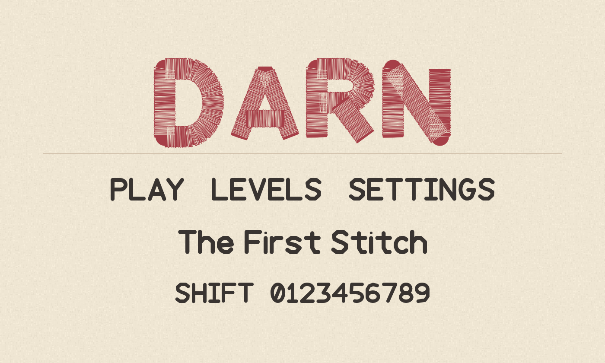
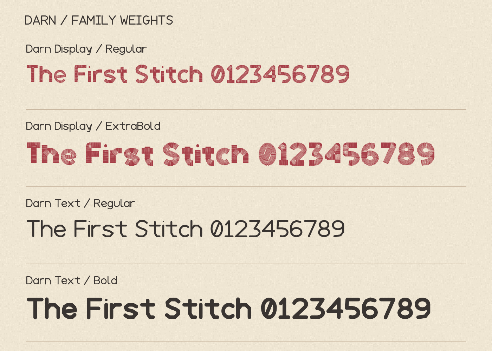
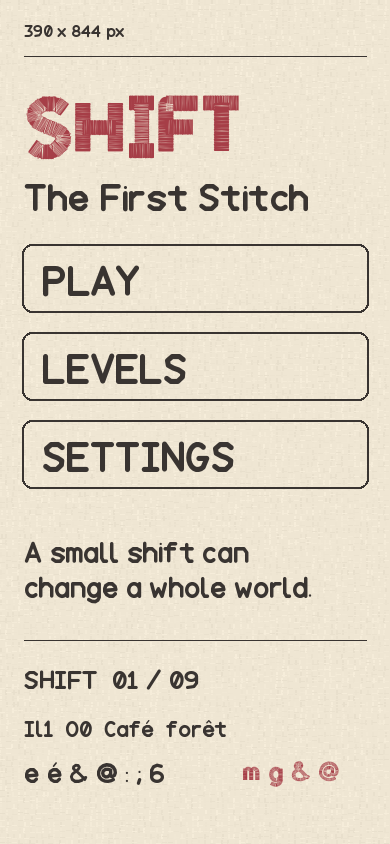
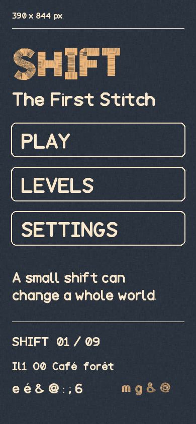
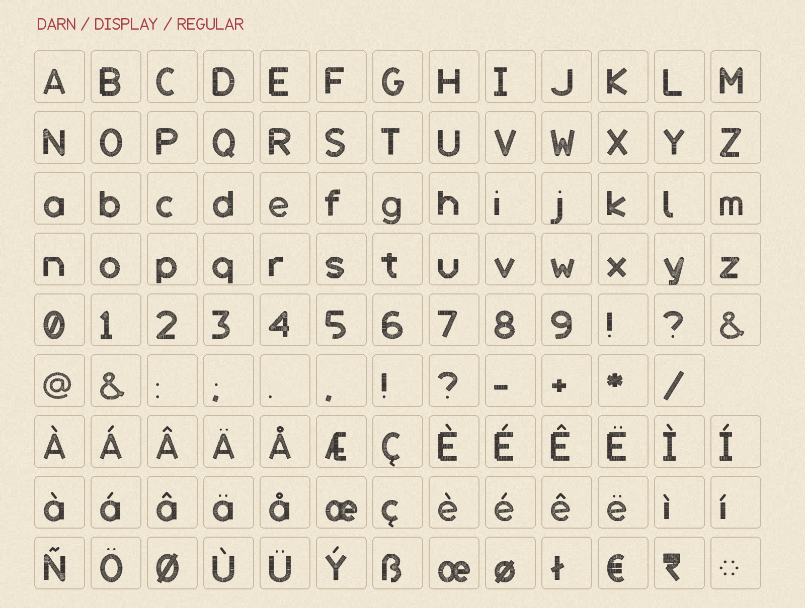
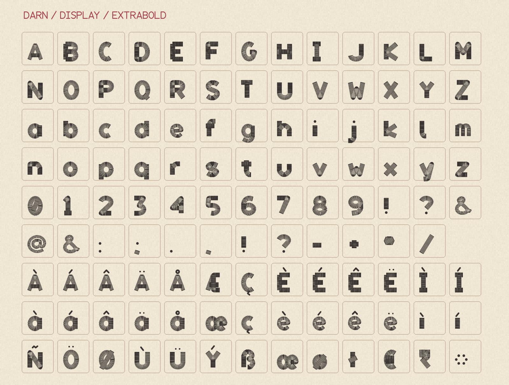
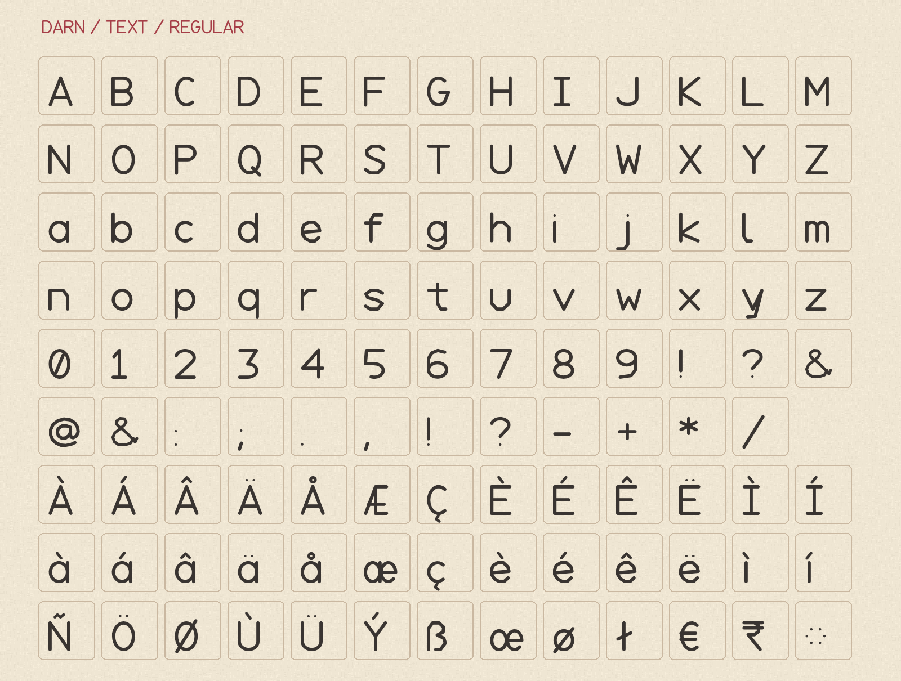
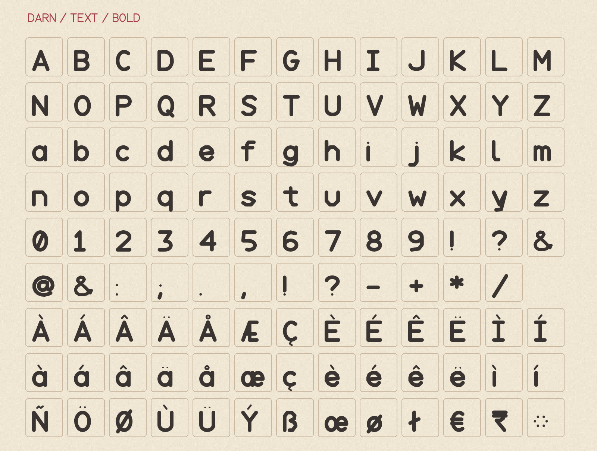

  

Darn is a stitched type family for games, with an embroidered display face and a clear companion for small text.
Display and Text each have Regular and heavier weights.
Every font maps 352 characters, including the Google Fonts Latin Core set.

Download [TTF and WOFF2 files](https://github.com/chaosmos-studio/darn/releases/latest).

## Specimens

## Characters

## License

Darn is available under the [SIL Open Font License 1.1](OFL.txt).
See [AUTHORS.txt](AUTHORS.txt) for the creators and [FONTLOG.txt](FONTLOG.txt) for its Threadline origin.

[Build instructions](sources/README.md)
