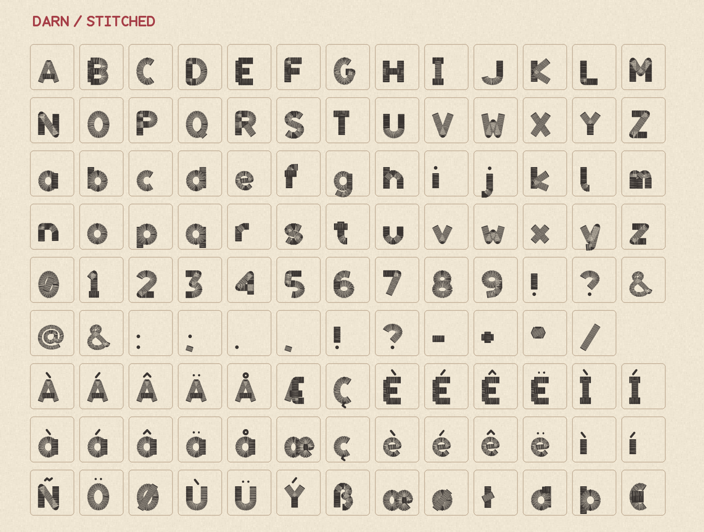
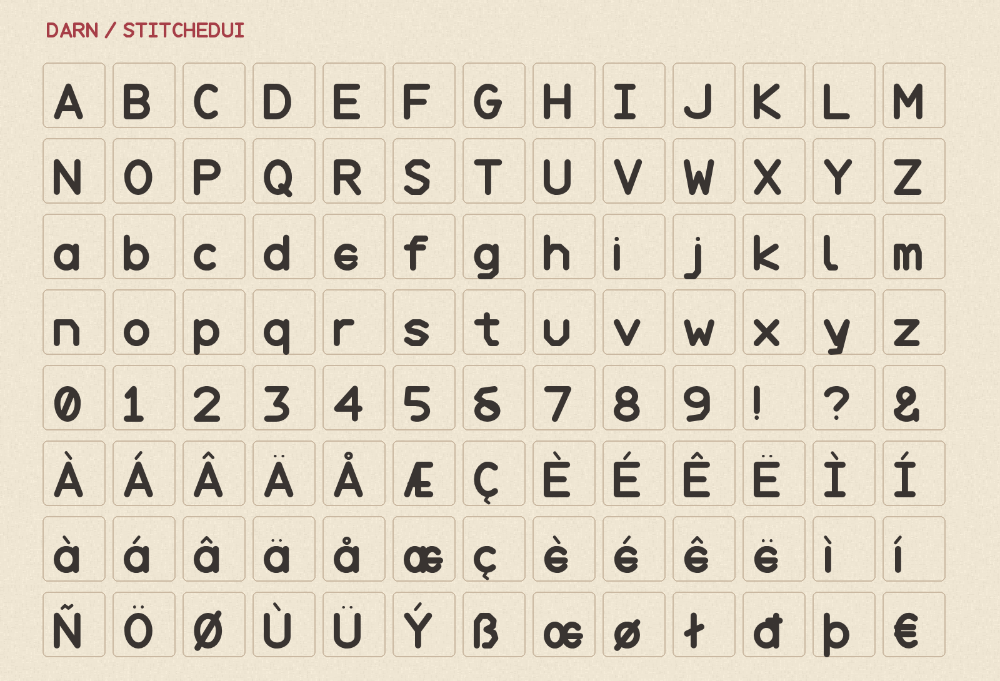

  

Darn is a stitched type family for games, with an embroidered display face and a clear companion for small text.

Download [Darn Display](fonts/Darn-Display.ttf) and [Darn UI](fonts/Darn-UI.ttf).

## Specimens

## License

Darn is available under the [SIL Open Font License 1.1](OFL.txt).
